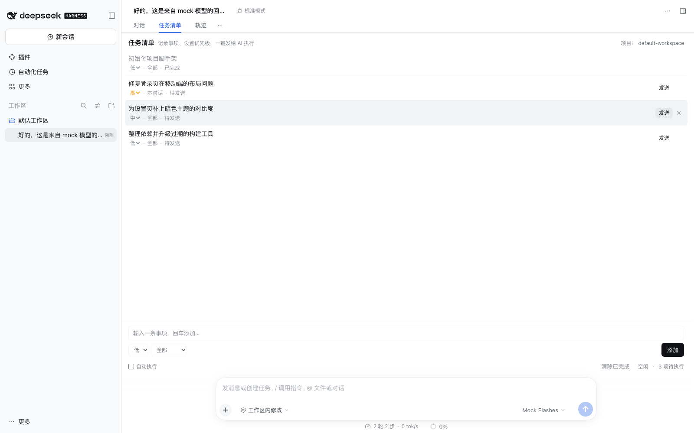
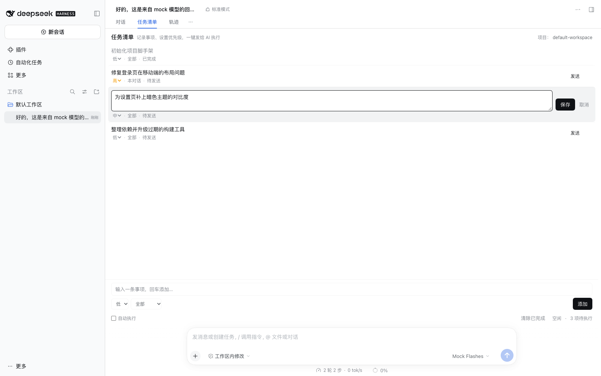
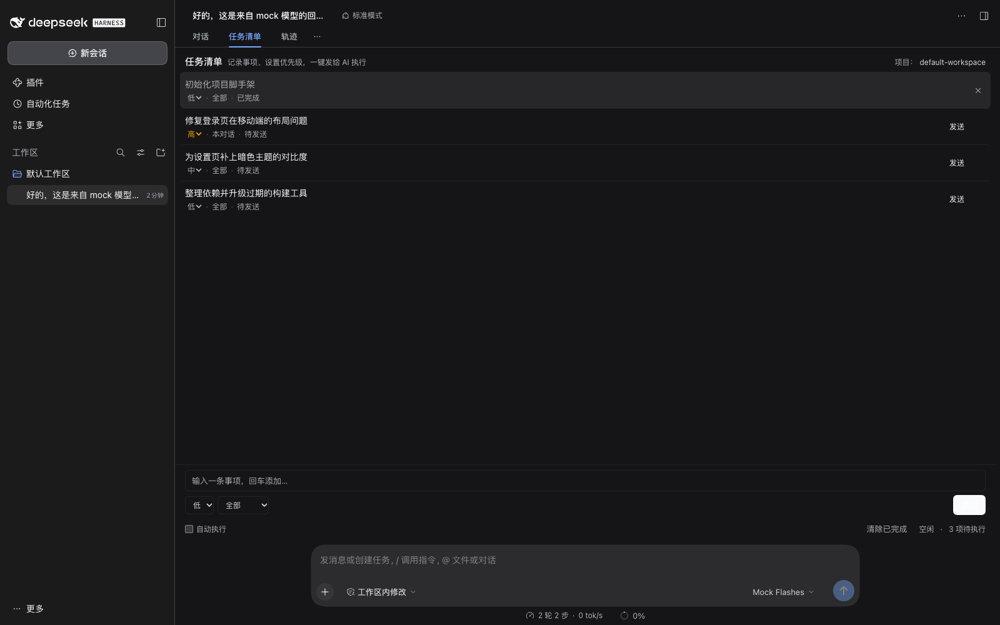

# dsh-task-queue

A task queue as a DeepSeek Harness conversation view.








English | [中文](#中文)

Record the things you need done, give each one a priority, and send it to the
conversation with one click — or let the queue send them by itself as soon as
the session goes idle, one item at a time, until the list is empty.

## Install

From npm (when published):

```sh
dsh plugin add dsh-task-queue
```

Or straight from GitHub:

```sh
dsh plugin add git+https://github.com/xuexue61/dsh-task-queue.git
```

You can also install it from the Plugins page with the same spec. Restart
DeepSeek Harness afterwards, then open a session and pick **Tasks** in the view
tab row (it sits before Trajectory).

## What it does

- **A conversation view, not a bolted-on panel.** It registers into the session
  view row next to Chat and Trajectory, so it uses the host's theme tokens,
  locale dictionaries and control conventions.
- **Lists are isolated per project.** Every workspace keeps its own list; a
  session in another project shows that project's items only, and the panel
  names the project the list belongs to.
- **Two scopes per item.** `This chat` keeps an item in the current
  conversation; `All` shows it in every conversation of the project.
- **Priorities.** High / medium / low, changeable in place from the item's own
  priority label; the queue is always ordered by priority.
- **One-click send.** Sending submits the item's text as a queued turn of the
  current conversation.
- **Auto-run, per conversation.** Turn on `Auto-run` and the plugin sends the
  highest-priority pending item whenever *this* session is idle, then waits for
  the turn to finish and sends the next one — even while you watch another view.
- **Progress per item.** pending / running / done / failed, with the error text
  when a send fails.
- **Editing.** Click an item's title to edit it (Enter saves, Shift+Enter adds a
  line, Esc cancels, clicking outside saves). Delete appears as a quiet icon on
  row hover. Done items sort to the top, new ones stay at the bottom.

Everything is stored in the browser's local storage, grouped by workspace. No
account, no network calls, no telemetry.

## Requirements

DeepSeek Harness `0.2.2-rc.1` up to (not including) `0.3.0`. The plugin is
plain JavaScript with no build step and no runtime dependencies.

## Development

The bundle is two files: `index.js` (a no-op Host half) and `client.js` (the
browser half, loaded through the DSH module loader). Locales live in
`locale/*.json`, the bundle row in `cordis.patch.yml`.

```sh
node --check client.js && node --check index.js
```

Install the checked-out directory through **Plugins → Add plugin** to try a
change; replacing an installed copy needs a DSH restart.

## License

MIT

---

## 中文

一个以「会话视图」形式出现的任务清单插件，装在 DeepSeek Harness 里。

把要做的事记下来，设好优先级，点一下就能交给当前会话执行；也可以打开「自动执行」，
让它在会话空闲时按优先级一条条自动发出去，直到清空。

### 安装

```sh
dsh plugin add dsh-task-queue
```

或直接从 GitHub 安装：

```sh
dsh plugin add git+https://github.com/xuexue61/dsh-task-queue.git
```

也可以在「插件 → 添加插件」里填同一个标识；装完重启 DeepSeek Harness，打开会话后
在视图标签行里选「任务清单」（在「轨迹」前面）。

### 功能

- **是一个会话视图**，和「对话」「轨迹」并列，沿用宿主的主题令牌、语言字典与控件规范。
- **按项目隔离**：每个工作区各有一份清单，切到别的项目的会话只显示那个项目的事项。
- **每条事项可选范围**：「这个对话」只在本会话出现，「全部」在本项目所有会话出现。
- **优先级**：高 / 中 / 低，点事项自己的优先级标签就能改；清单始终按优先级排序。
- **一键发送**：把事项文本作为一条排队消息发给当前会话。
- **自动执行按对话独立**：打开后只对当前会话生效，会话空闲时自动发最高优先级的一条，
  等这一轮结束再发下一条，切换到别的视图也会继续。
- **进度**：待发送 / 执行中 / 已完成 / 发送失败（附错误信息）。
- **编辑**：点任务标题即可改（Enter 保存、Shift+Enter 换行、Esc 取消、点外面自动保存）；
  删除是悬停行尾才出现的轻量图标；已完成的排在上面，新加的落在下面。

数据只存在浏览器本地存储，按工作区分组；不联网、不需要账号、没有遥测。

### 环境要求

DeepSeek Harness `0.2.2-rc.1` 及以上、`0.3.0` 以下。纯 JavaScript，无构建步骤、无运行时依赖。

### 许可证

MIT
